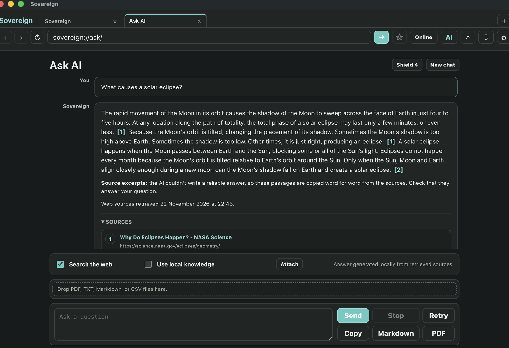
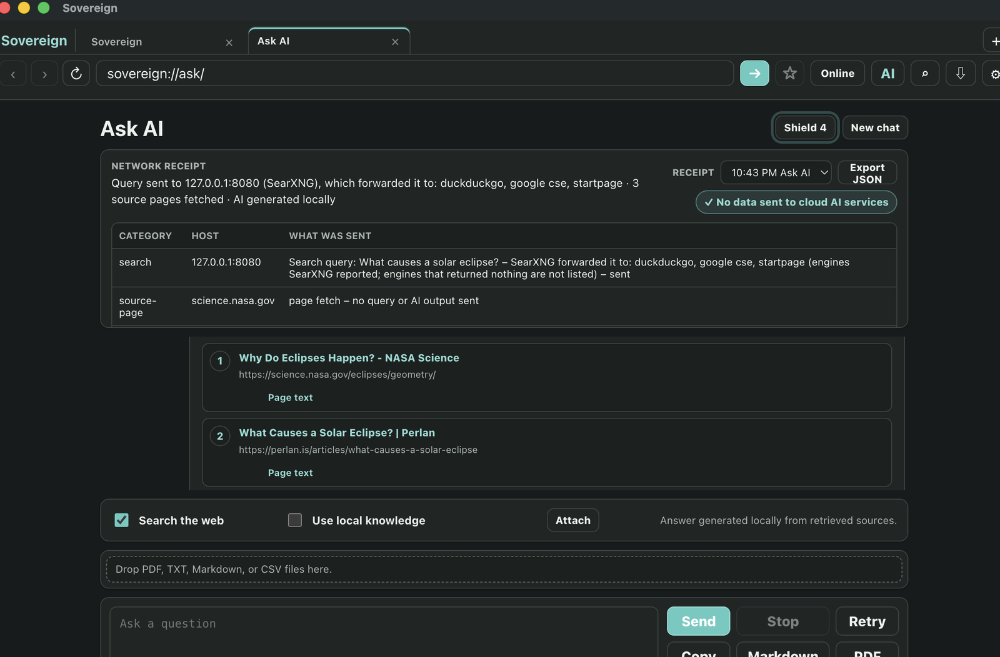
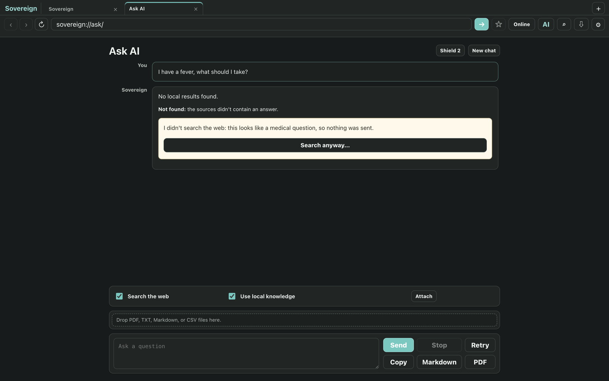
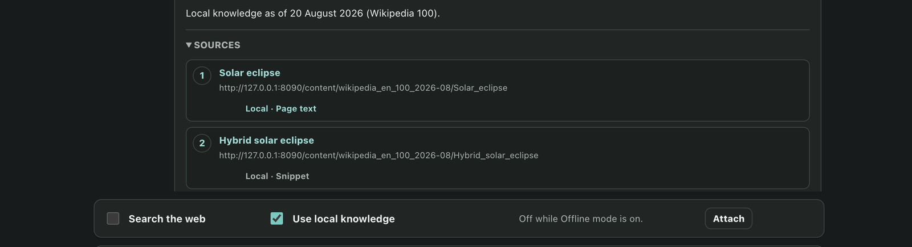
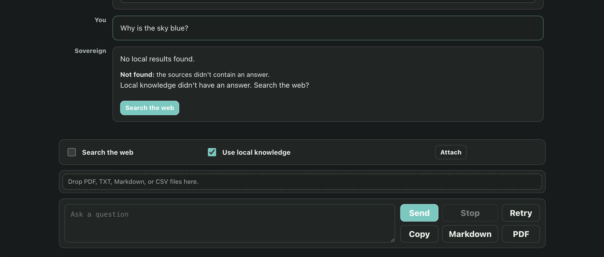
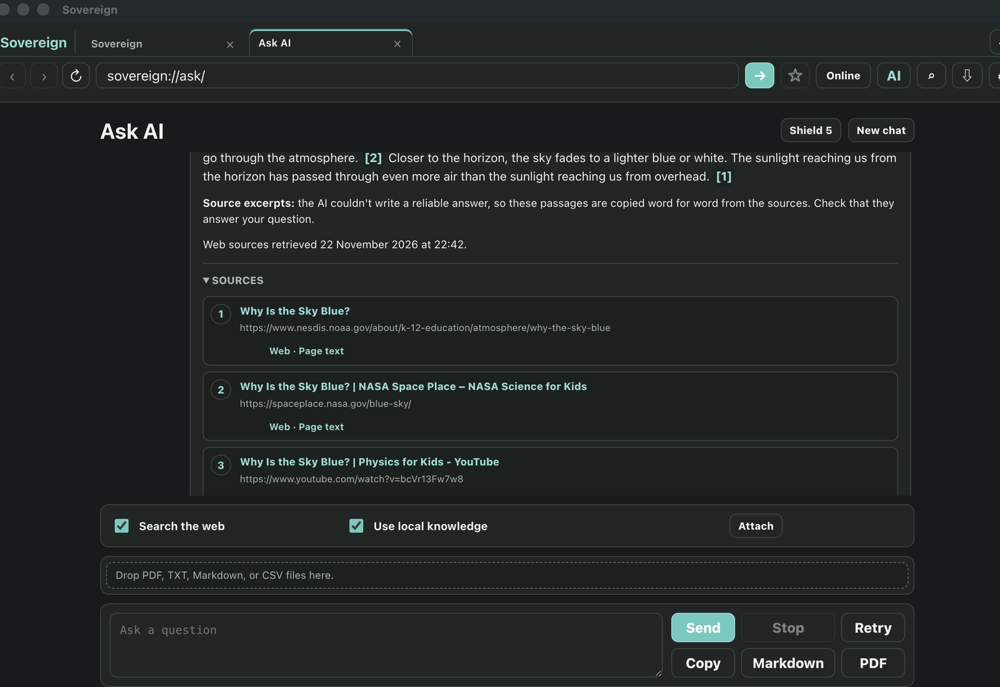
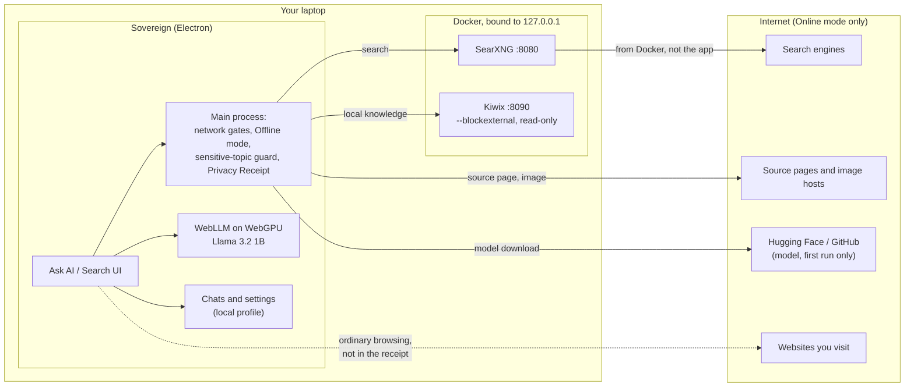
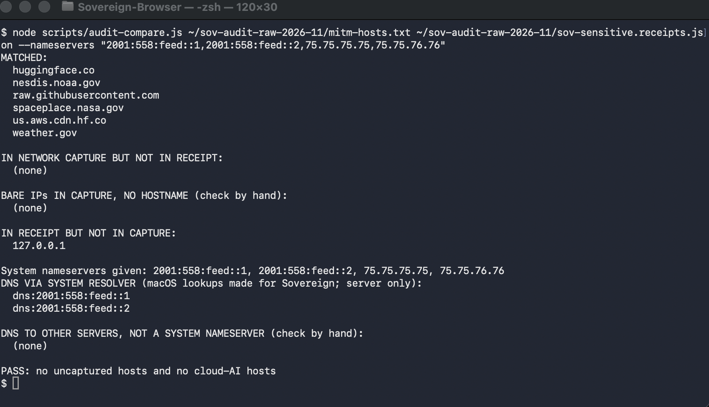
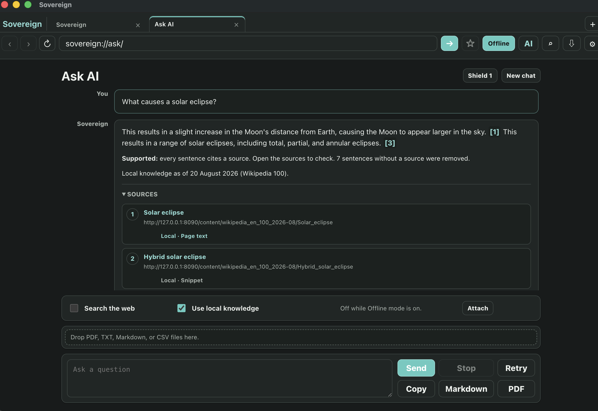

# Sovereign Browser

**A desktop research browser whose AI runs on your laptop, and which shows you every request that leaves it.**

## Abstract

Research assistants built on large language models usually send users’ questions, documents and chat histories to cloud services, and users cannot see what leaves their device. The risk is greatest for sensitive questions about health, money, immigration or personal crises. We present Sovereign, an Electron desktop browser that runs a small language model (Llama 3.2 1B, 4-bit) entirely on the user’s laptop through WebLLM and WebGPU, with no cloud fallback. Sovereign combines five mechanisms: a per-question Privacy Receipt listing every network request and its purpose; an Offline mode that blocks the app’s traffic except to allowlisted local services; a sensitive-topic guard that checks questions in 15 categories before any search and answers crisis messages with fixed support resources; offline encyclopedia retrieval from a loopback-only Kiwix server; and trust labels, computed in code, that show whether each sentence cites a source, remove uncited sentences and flag numerical disagreements between sources. We evaluated it with automated unit and end-to-end tests, Offline network probes, a hostname capture compared against the receipt, a packet capture of the knowledge server, and recorded manual test rounds. In fresh audits of the current build, which captured every non-loopback connection made by the app's processes, every captured host appeared in the receipt and no cloud AI host was contacted; Offline, the app made no connections; a blocked sensitive question added no traffic; the knowledge server sent no outbound traffic; and blocked Offline probes sent no packets. Limits remain: “Supported” confirms that citations are present, not that they are faithful; the guard’s English pattern rules miss some phrasings and over-block others; crisis texts await professional review; Offline mode covers only this application; and answer accuracy is not yet measured.

## Contents
[Research question](#research-question) · [What Sovereign does](#what-sovereign-does) · [Architecture](#architecture) · [Evaluation](#evaluation) · [Guarantees and known limits](#privacy-guarantees-and-known-limits) · [Setup](#setup) · [Testing](#testing) · [Status and roadmap](#status-and-roadmap) · [Licence and credits](#licence-and-credits)

Every claim in this README is linked to code, a test or a recorded check in **[docs/evidence.md](docs/evidence.md)**. Claims that are only partly proven are worded with their limits, and claims that can't yet be proven are not made.

## Research question

Can a research assistant that people use for real, and sometimes sensitive, questions keep its AI entirely on the user's laptop, make every remaining network request visible, and be honest about how much each answer can be trusted?

Sovereign is a working prototype that tests this on an ordinary laptop. It is built for students, researchers and anyone who would rather not hand their questions to a cloud AI.

## What Sovereign does

Each feature below links to its evidence row in [docs/evidence.md](docs/evidence.md).

### Local AI (C1, C2, C2a, C22)
Answers are generated on the laptop with [WebLLM](https://github.com/mlc-ai/web-llm) on WebGPU. The default model is Llama 3.2 1B Instruct (4-bit, MLC build). The app has no cloud AI fallback: if the model isn't ready, it says so. The model is downloaded **once**, on first use, from Hugging Face and GitHub, and is cached afterwards. That download appears in the Privacy Receipt and never happens while Offline. With the model on disk, Ask AI answers Offline.

### Privacy Receipt (C3, C3a, C3b)
Every request the app makes for search, answers, images, model setup and local knowledge is listed per question, with its destination host and purpose (for example "search", "source page", "local knowledge"). Each receipt is checked against a list of known cloud AI hosts. Receipts can be exported as JSON. A documented procedure ([docs/privacy-audit.md](docs/privacy-audit.md)) compares the receipt with an independent hostname capture.

Normal website tabs are not included in the receipt; they are ordinary browsing. Image thumbnails are loaded directly from the search engines' image servers and are listed as image rows; those servers see your IP address and which thumbnails are fetched.


*A web answer to "What causes a solar eclipse?". The AI couldn't write a reliable answer, so Sovereign shows passages copied word for word from the sources, keeps the citations and labels the answer **Source excerpts**.*


*The Privacy Receipt for that answer. The query went to the local SearXNG (`127.0.0.1:8080`), which forwarded it to duckduckgo, google cse and startpage. Each source page was fetched with no query or AI output (`science.nasa.gov` row shown), and the receipt reports "No data sent to cloud AI services".*

### Offline mode (C4–C7)
New installs start **Offline**. A profile created before Offline mode existed starts Online and shows a one-time choice; after that, the user's choice is remembered. While Offline, the app's requests are blocked at several layers (request filtering, a proxy that drops traffic, and a content security policy on pages), except to local services the user adds to an allowlist. Probes for WebTransport, WebRTC STUN and beacons sent no packets while Offline in the end-to-end tests. Separately, redirects to private network addresses are refused in both modes.

### Sensitive-topic guard (C8, C8a, C9)
Before any web search, image search, source reading or local-knowledge search, the question is checked against 15 categories, including health, mental health, legal, financial, immigration, and sexual orientation or gender identity. A flagged question is not searched; the user sees a notice and can choose [Search anyway…]. The default setting, Strict, also flags general questions in these areas. Messages about self-harm or harming others are checked first, receive a fixed reply with support resources, and never reach any search.


*A medical question with Search the web on. Sovereign didn't search the web, says why, and offers [Search anyway…]. Local knowledge, which stays on this computer, found nothing.*

### Local knowledge with Kiwix (C10–C12)
Ask AI can answer from offline copies of Wikipedia and similar collections (ZIM files) served by [Kiwix](https://kiwix.org) on `127.0.0.1`. The Kiwix container is pinned by digest, read-only, and started with `--blockexternal`. Local answers cite the local article and show "Local knowledge as of <date>". Results whose titles don't match the question are dropped, so the app says **Not found** rather than cite an unrelated article. It then offers a web search when Online and the question isn't sensitive.


*A local-knowledge answer while Offline (cropped to its sources). The sources are Wikipedia 100 articles served by Kiwix on `127.0.0.1:8090`, the answer says "Local knowledge as of 20 August 2026 (Wikipedia 100)", and Search the web is off while Offline mode is on.*


*The local collection had no article for "Why is the sky blue?", so Sovereign says **Not found** instead of citing an unrelated article, and offers a web search.*

### Answer trust labels (C13–C15)
Each answer is labelled:

| Label | Meaning |
|---|---|
| Supported | Every sentence cites a source. Open the sources to check. |
| Partly supported | Some sentences have no source. |
| Source excerpts | The model couldn't write a reliable answer, so passages are copied word for word from the sources. |
| Not found | The sources didn't contain an answer. |
| No sources | The answer is from the AI alone. |

Sentences without a valid citation are removed, and the app says how many. When sources give different values for the number the question asks about, the answer shows "Sources disagree" with each value and its source.

**"Supported" does not mean verified.** It checks that each sentence has a citation, not that the cited source says it (see [limits](#privacy-guarantees-and-known-limits)).


*Another web answer shown as **Source excerpts**, with each source's address and where its text came from ("Web · Page text"). The label tells you to check that the passages answer the question.*

### Everyday browsing
Tabs and detachable windows, an address bar, bookmarks, downloads, web search through a local [SearXNG](https://github.com/searxng/searxng) instance, page summaries, and questions about attached PDF, TXT, MD and CSV files, which are parsed on the laptop (C17).

## Architecture



**What can leave the laptop:** search queries (through SearXNG to its search engines), requests for the source pages and images an answer uses, the one-time model download, and the websites you visit. All except ordinary browsing are listed in the Privacy Receipt. While Offline, none of these are sent.

**What does not leave the laptop:** your prompts to the AI, the model's answers, attached documents and chat history. None of them are sent to any AI service.

## Evaluation

| Method | What it checks | Where |
|---|---|---|
| Unit and integration tests (21 files, run by `npm run check`) | Receipt attribution, Offline gates, safe redirects, guard categories and gate ordering, Kiwix parsing and relevance, trust labels, the audit scripts | `tests/` |
| End-to-end tests in Electron (20 suites) | The running app: Offline phases with UDP and WebTransport probes, guard behaviour, local knowledge answers and labels, redirects, attachments, deletion | `tests/electron/` |
| Hostname audit | mitmproxy's macOS local capture of every connection made by Sovereign's own processes, compared with the exported receipt | [docs/audits/](docs/audits/) (summaries), [RUNBOOK](docs/audits/RUNBOOK.md) |
| Container capture | Packet capture inside the Kiwix container's network during use, plus a source review of kiwix-serve | [docs/audits/2026-11-22-kiwix-capture-summary.txt](docs/audits/2026-11-22-kiwix-capture-summary.txt); [docs/HANDOFF.md](docs/HANDOFF.md) (Task 2a, Round 4 review) |
| Manual test rounds | Each feature retested by the author before it was accepted, including sensitive-chat exports | [docs/HANDOFF.md](docs/HANDOFF.md) (review entries per task) |

**Results so far** (current build; each summary is in [docs/audits/](docs/audits/))
- **Method check (dry run, 2026-11-19):** the capture saw both the main process's own requests (source pages read for answers) and the browser engine's (image thumbnails, website tabs). PASS.
- **Online (2026-11-19, new profile, model downloaded during the run):** 13 hosts, every one listed in the receipt; no cloud AI host; no unnamed connections; DNS only to the Mac's own nameservers. PASS.
- **Offline (2026-11-19, whole run Offline):** no connection and no DNS lookup by Sovereign's processes. The receipt lists only local Kiwix and the blocked test website. PASS.
- **Sensitive chat (2026-11-20, Online, Strict):** after the sensitive question, 0 new hosts compared with a baseline taken once the model had loaded. The sensitive word appears 0 times in the exported receipt and 0 times in the capture, and that chat's receipt says "Not sent: sensitive topic (medical)". PASS.
- **Kiwix (2026-11-22, Offline, 6 questions):** 45 connections, all inbound to Kiwix's own port; 0 outgoing packets, and no DNS, UDP, ICMP or IPv6 traffic. PASS. The local model wrote a cited answer during this run, so Ask AI answered Offline.
- **Offline probes (end-to-end tests):** WebTransport to a non-allowlisted local port sent 0 datagrams Offline (1 in the Online control); STUN and beacons sent nothing.
- An earlier audit (2026-09-24, older build and method) is superseded by these; its record stays in `demo/audit-result.txt`.


*`audit-compare` on the sensitive-chat run's raw files: every host Sovereign's processes contacted is in the receipt (MATCHED: the model files, then the control question's sources), nothing is uncaptured, and DNS went only to the Mac's own nameservers. PASS.*
- **Answer accuracy: not yet measured.** A small evaluation set exists (`tests/evals/research-answer-quality.json`) but has no recorded results.

**Limits of this audit**
- It records hostnames only (TLS passthrough), not paths or contents.
- Only Sovereign's own processes are captured (by executable path, plus the DNS lookups macOS makes for them). Traffic that other apps or the operating system make is not captured.
- DNS lookups go through macOS's resolver. macOS attributes the lookups it makes for Sovereign to Sovereign, so the capture records them as `dns:<DNS server>` lines. That shows which DNS servers were asked, not which names. The audit accepts only the Mac's own nameservers.
- The first dry run (2026-11-19) found that Chromium inside the app sent its own DNS and upgraded to the network provider's encrypted DNS server (`doh.xfinity.com`), which the receipt did not list. Sovereign now turns this off, so all of the app's DNS goes through macOS (see "DNS" below). The next dry run confirmed it: no DoH host, and a packet-level check showed that the app's lookups were sent by macOS's resolver, not by the app itself.
- Local services (SearXNG, Kiwix) on `127.0.0.1` are not captured. SearXNG's requests to search engines come from its Docker container, not from the app, so they appear in neither the capture nor the receipt.
- Image thumbnails come straight from the search engines' image servers (for example `encrypted-tbn0.gstatic.com` and Bing's `ts*.mm.bing.net`). They are listed in the receipt as image rows, and those servers see your IP address and which thumbnails are fetched.
- Offline is shown in two parts. The Offline run shows that Sovereign sent nothing; the Kiwix run shows that the local model answers Offline, but it captured the Kiwix container, not Sovereign. No single run shows both.
- In the sensitive run, the receipt export counts 2 requests with no known origin, which no receipt lists. Every captured host matched the receipt, so they went to listed hosts or stayed on the machine. Why they weren't attributed is still being investigated.
- Each scenario was run once, on one Mac (macOS 26.6.2) and one home network.

Changes were made in small tasks, each with a written plan, tests written first, a review and a manual test by the author before acceptance. The full log is in [docs/HANDOFF.md](docs/HANDOFF.md).

## Privacy guarantees and known limits

| What Sovereign guarantees (with the evidence in [docs/evidence.md](docs/evidence.md)) | Known limits |
|---|---|
| AI answers are generated on the laptop; no cloud AI fallback. | Answer quality is limited by a 1B-parameter model and by what the chosen Kiwix collections cover. |
| App requests for search, answers, images, model setup and local knowledge are listed in the Privacy Receipt. | Ordinary browsing tabs are not in the receipt. SearXNG's requests to search engines come from Docker, not the app. Image servers see your IP address and which thumbnails are fetched. In one audit run, 2 requests had no known origin and were not listed. |
| Offline mode (the default for new installs) blocks the app's traffic except to allowlisted local services. | Offline mode covers this app only, not other apps or the operating system. A local service on the allowlist could forward traffic to the internet. |
| While Offline, `http(s)` pages can't open WebTransport, STUN or beacon connections. | A `file:///` page can still open WebTransport to a local port. A QUIC handshake started while Online may repeat for about 4 seconds after switching. A running service worker may keep a connection it already had open. |
| Sensitive questions are checked before any search; crisis messages never reach search. | The guard uses English pattern rules: it misses indirect wording and other languages, and over-blocks some harmless questions. It is not a safety service and contacts no one. The crisis texts and helpline numbers await professional review and re-verification before public release. |
| Kiwix is bound to `127.0.0.1` and showed no outbound traffic. | The Kiwix search format is undocumented; the image is pinned so a future version can't change it silently. |
| Each answer carries a trust label; uncited sentences are removed. | **"Supported" ≠ verified.** In one manual test, a Supported answer about solar eclipses included a made-up sentence and a false one, both with citations. Open the sources to check. Claim-level faithfulness checking is future work. |
| Deleting a chat removes the app's copy. | Chromium may keep old bytes until it compacts its storage. Exported receipts and backups are outside the app. |


*Supported is not verified. Offline, "What causes a solar eclipse?": every kept sentence cites a source, so the label is **Supported**, but the first says a farther Moon looks larger (it looks smaller), and the second doesn't answer the question. Its [3] is a third local article, below the part shown. Open the sources to check.*

Running AI locally does not make browsing anonymous: websites and search engines still see your connection and requests when Online.

**DNS.** Sovereign looks up website names through macOS's own resolver, for both the browser engine and the app's own requests. It does not use its own encrypted DNS (DNS-over-HTTPS) or Encrypted Client Hello. That keeps all the app's DNS in one place that the privacy audit can account for. The trade-off: unless macOS is set up for encrypted DNS, the names of the sites you visit or search results the app reads can be seen on the network, for example by others on public or untrusted Wi-Fi, and by your network provider. For protection across the whole system, turn on encrypted DNS in macOS, for example by installing an encrypted-DNS configuration profile from a DNS provider you trust. iCloud Private Relay covers Safari only, not Sovereign.

**Development runs.** In development runs (`npm start`), leftover test environment variables can weaken protections. A stricter gate is planned in Task 2d ([docs/evidence.md](docs/evidence.md), C23).

## Setup

**Requirements:** macOS (development platform), Node.js and npm, a GPU with WebGPU support, and Docker Desktop for SearXNG and Kiwix.

```bash
npm install
npm start
```

On first use, Ask AI downloads the model (about 705 MB, plus a small WebGPU runtime library) from Hugging Face and GitHub. This needs Online mode and is recorded in the Privacy Receipt. Afterwards the model is cached and Ask AI works Offline.

**Web search (SearXNG).** The SearXNG and Kiwix images are pinned by digest, so `docker compose` always runs the same reviewed image. Set your own secret, then start the container bound to `127.0.0.1:8080`:

```bash
cd searxng
SEARXNG_SECRET="$(openssl rand -hex 32)" docker compose up -d
```

In Settings, set **SearXNG endpoint** to `http://127.0.0.1:8080/search`.

**Local knowledge (Kiwix).** Follow [docs/local-knowledge-setup.md](docs/local-knowledge-setup.md). It covers disk space, downloading and checksum-verifying the ZIM files (Set A: Wikipedia top articles, MDWiki medical articles, Wikivoyage; 9.57 GB), starting Kiwix on `127.0.0.1:8090`, and enabling it in Settings. Start with the small Wikipedia 100 test file.

## Testing

```bash
npm run check                            # syntax checks, unit and integration tests
npm run test:electron:offline-mode       # one end-to-end suite; others: package.json "test:electron:*"
```

The Electron suites open real app windows with a throwaway profile. `test:electron:media-chat-live` needs the internet. To repeat the privacy audit, follow [docs/audits/RUNBOOK.md](docs/audits/RUNBOOK.md) (the older session-proxy method is in [docs/privacy-audit.md](docs/privacy-audit.md)).

## Status and roadmap

**Done:** Phase 0 (browser, local AI, receipt), Phase 1 (Offline mode, sensitive-topic guard), Phase 2 (local knowledge with Kiwix, answer trust labels). Fresh privacy audits of the current build (Online, Offline, sensitive chat, Kiwix) are done ([docs/audits/](docs/audits/)). Still pending: tests with the full Set A collections.

- **Phase 3:** local image generation on the laptop, starting with a feasibility test.
- **Phase 4:** integrate a fine-tuned, citation-faithful model (MLC conversion) and choose the model size. A dataset-collection mode exists in this repository (`src/dataset-collection.js`). LoRA fine-tuning of Llama 3.2 1B for citation faithfulness is in progress outside this repository. No fine-tuned model is used by the app yet.
- **Phase 5:** claim-level faithfulness evaluation, multi-seed runs, repeated privacy audits on more machines and networks, and a paper submission.

## Licence and credits

Sovereign is released under the [MIT License](LICENSE). Components keep their own licences: the Llama 3.2 model is under the Llama 3.2 Community License; Wikipedia and other ZIM content is under its own licence (Wikipedia: CC BY-SA).

Built with [Electron](https://www.electronjs.org), [WebLLM / MLC](https://github.com/mlc-ai/web-llm), [Llama 3.2](https://www.llama.com), [SearXNG](https://github.com/searxng/searxng), [Kiwix](https://kiwix.org) and openZIM, and [pdf.js](https://mozilla.github.io/pdf.js/).

Built with AI coding assistants (Claude Code as planner and reviewer, Codex as builder) under a documented approval-gate workflow ([AGENTS.md](AGENTS.md)). All decisions and manual tests are by the author, Sandeep Shah. Screenshots are real captures, cropped and resized with AI assistance.

## Before releasing

- Re-verify every resource in `src/sensitive-guard.js` against the official services before each release: 988 (US and Canada), Samaritans 116 123 (UK and Ireland), Lifeline 13 11 14 (Australia), National Domestic Violence Hotline 1-800-799-7233 (US), National Domestic Abuse Helpline 0808 2000 247 (UK), and findahelpline.com. Only then update the pending last-verified comments. Have `CRISIS_REPLY`, `CRISIS_SHORT_LINE`, `HARM_REPLY` and `ABUSE_RESOURCES` reviewed by a qualified professional before public release.
