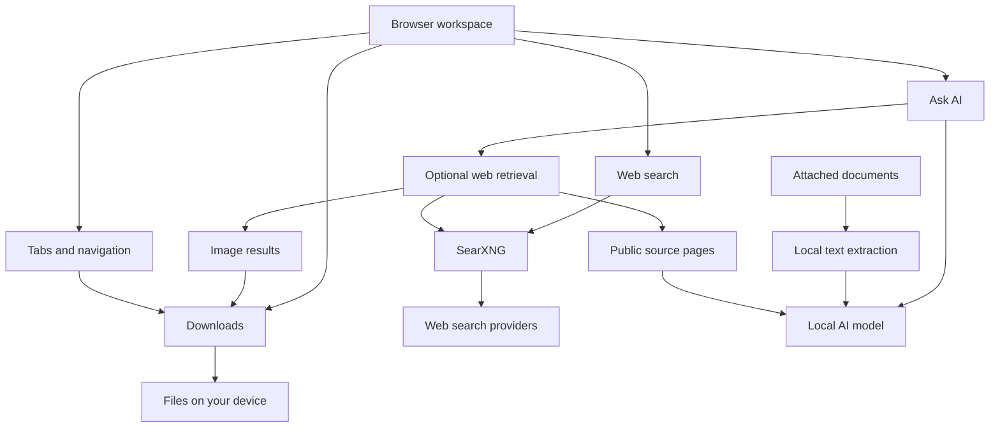

# Sovereign Browser

### Browse, research, and work with local AI.

Sovereign is an Electron-based desktop browser that brings web search, conversational AI, document questions, and media downloads into one workspace.

Built for students, researchers, and curious minds, Sovereign focuses on keeping AI processing local while making online research easier to follow and verify.

---

## Preview


## Features

### Everyday browsing
- Multiple tabs and detachable browser windows.
- Address bar with navigation controls.
- Custom home page with website shortcuts.
- Integrated downloads with progress tracking.

### Search and research
- Web search through a configured SearXNG instance.
- Separate **Search** and **Ask AI** experiences.
- Source links and clickable citations in supported research answers.
- Optional source-page reading for more context than search snippets alone.

### Local AI conversations
- Conversational interface with follow-up questions.
- Streamed responses and generation controls.
- Page summaries from the browser’s AI panel.
- Local model setup and readiness feedback.

### Documents and media
- Attach supported documents to Ask AI.
- Ask questions about successfully extracted document content.
- Find images within an AI conversation using web retrieval.
- Copy original-image links and download available images through the browser.

> Document support depends on successful text extraction. Image-only PDFs may require OCR. Media availability depends on the source website.

## How it works



AI generation runs locally. Web search and source retrieval use network connections to obtain information.

## Technology

| Component | Technology |
|---|---|
| Desktop application | Electron |
| Interface | HTML, CSS, JavaScript |
| Browser views | Electron WebContentsView |
| Local AI | WebLLM |
| Web search | SearXNG |
| Search service deployment | Docker Compose |
| Development tooling | Node.js and npm |

The current local AI setup uses Llama 3.2 1B Instruct. Model availability and performance depend on the application configuration and device capabilities.

## Getting started

### Requirements

- Node.js and npm
- A system compatible with the project’s Electron version
- WebGPU support for local AI inference
- Internet access for initial model setup and online browsing
- Docker and Docker Compose if running the bundled SearXNG service

### Install and launch

From the project directory:

```bash
npm install
npm start
```

The initial AI setup downloads model assets. Once cached, those assets can be reused for local inference.

### Start the search service

To use the bundled SearXNG configuration:

```bash
cd searxng
docker compose up -d
```

Configure Sovereign’s search endpoint as:

```text
http://127.0.0.1:8080/search
```

The local search service must be running for searches through this endpoint to succeed.

## Using Sovereign

| Goal | Action |
|---|---|
| Visit a website | Enter its address in the address bar |
| Search the web | Choose **Search** and enter a query |
| Ask a question | Choose **Ask AI** and send a message |
| Research with online evidence | Enable web retrieval in Ask AI |
| Read more source material | Turn on **Search the web** in Ask AI. Sovereign automatically reads up to the top 3 source pages and answers from them; each page appears in the Privacy Receipt as a `source-page` entry |
| Ask about a document | Attach a supported file and wait for extraction |
| Find an image | Request an image and enable image retrieval when prompted |
| Save an image | Use **Download** on the selected image card |
| Check supporting material | Open the answer’s citation links |

## Privacy

Sovereign separates local AI processing from online information retrieval.

| Activity | Processing or destination |
|---|---|
| AI response generation | Local model on your device |
| Supported document extraction | Local processing |
| Model setup | Downloads assets from model hosts |
| Web search | Configured SearXNG instance and its upstream providers |
| Source-page reading | Contacts the selected websites |
| Image retrieval and downloading | Contacts search services and media hosts |
| Ordinary browsing | Connects to the websites you visit |

Local inference does not make web browsing anonymous. Websites and search services can receive connection information and requests.

Sovereign does not silently fall back to a cloud AI service when the local model is unavailable.

## Research limitations

Sovereign is a research assistant. Review important claims against their original sources.

- Local models can produce inaccurate or incomplete answers.
- Citations make sources easier to inspect; they do not guarantee correctness.
- Search snippets may omit important context.
- Some websites restrict automated retrieval or require authentication.
- Long documents may exceed processing or model-context limits.
- Scanned, encrypted, or malformed PDFs may not yield usable text.
- Original media links may expire or become unavailable.
- A downloadable image is not necessarily licensed for unrestricted reuse.

## Development

Run the project’s configured checks:

```bash
npm run check
```

When changing browser behavior, also verify the relevant user flow in the running application.

Use an isolated test profile for automated browser tests so normal browsing data remains separate.

## Contributing

Contributions that improve reliability, accessibility, research quality, and privacy are welcome.

Before submitting a change:

1. Describe the problem and expected behavior.
2. Keep the change focused.
3. Run the relevant checks.
4. Explain what you tested and any remaining limitations.
5. Document changes to setup or user-facing behavior.

For bug reports, include your operating system, reproduction steps, and relevant error messages. Remove personal information from screenshots and logs.

## Project status

Sovereign is under active development. Features and interfaces may change as the browsing, document, and local AI workflows improve.

## Acknowledgments

Built using Electron, WebLLM, SearXNG, and the open-source tools that support them.